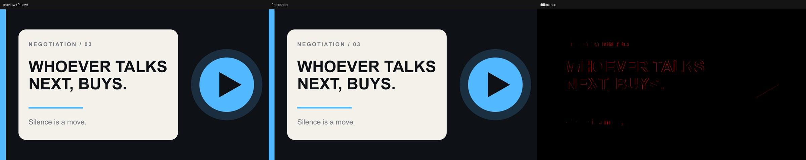

# design-engine

Design estático como **dado**. Uma cena escrita em Python vira uma lista de camadas (o *IR*), e três players tocam essa
mesma lista:

- `lib/preview.py` → um PNG desenhado com Pillow. É o mock de aprovação: não precisa de nenhum app da Adobe aberto.
- `lib/runtime_ps.jsx` → um documento **editável e em camadas** dentro do Photoshop aberto (shape layers, texto vivo, grupos,
  imagens como smart object).
- `lib/runtime_ai.jsx` → um documento **vetorial editável** dentro do Illustrator aberto (paths, texto vivo, grupos, imagens
  linkadas).

O que foi aprovado no preview é o que chega no app. Depois de cada build o próprio motor confere isso: o app exporta um PNG de
conferência, o motor compara com o preview e imprime `ORDER` (a árvore de camadas que o app reporta contra o IR) e `PARITY`
(quanto as duas imagens são iguais).



Gratuito e aberto (MIT). Projeto independente, sem vínculo com a Adobe. Windows, Photoshop e Illustrator instalados por você.

## Começo rápido

```python
import sys; sys.path.insert(0, r"<repo>/lib")
from engine import Doc, ACCENT, INK, PAPER, fit_size

d = Doc("Thumb", 1280, 720, bg=INK)
d.rect("Card", (88, 96, 760, 528), fill=PAPER, radius=36)
s = fit_size("WHOEVER TALKS\nNEXT, BUYS.", 664, hi=120)          # o maior tamanho em que a linha mais larga cabe
d.text("Title", "WHOEVER TALKS\nNEXT, BUYS.", (136, 300), size=s, fill=INK, max_w=664)
d.ellipse("Disc", (950, 230, 260, 260), fill=ACCENT)
d.save("thumb.ir.json")
```

```
python lib/preview.py thumb.ir.json thumb.png                              # mock, sem app nenhum
python lib/build.py thumb.ir.json --app ps --sheet thumb_ps.jpg            # Photoshop aberto
python lib/build.py thumb.ir.json --app ai --sheet thumb_ai.jpg            # Illustrator aberto
```

Um exemplo completo está em [`examples/thumb.py`](examples/thumb.py). A API inteira está em [`docs/API.md`](docs/API.md).

## O que o motor garante

- **Nunca abre o app sozinho.** `tools/run_jsx.ps1` recusa (`ABORT`) se o Photoshop ou o Illustrator não estiver aberto.
- **Sempre um documento NOVO.** Não toca, não salva e não fecha nada que já estava aberto, e não salva o documento que criou.
  Os únicos arquivos que ele escreve são o PNG de conferência e o log, na pasta de rascunho.
- **Texto que não cabe estoura no Python, não no app.** `max_w` em `text()` levanta `Overflow` com os números.
- **A largura medida é a largura que o app compõe.** O kerning vem do próprio arquivo da fonte (`lib/kerning.py`) e o tracking
  entra entre os glifos, como o Photoshop e o Illustrator fazem. No teste, o texto bate no pixel nos dois apps.
- **Fonte que falta é `WARN`, nunca aborto.** O build continua com a fonte padrão do app e avisa qual camada foi.

## Núcleo e marcas

O repositório é só o **núcleo**. Tudo que é de um cliente (paleta, fontes, cenas) mora num **pacote de marca** em
`brands/<nome>/`, que fica **fora do git** (só `brands/demo/` é versionado). Para atender um cliente novo você nunca edita
`lib/`: copia `brands/demo/`, troca o que o cliente precisa e aponta `"brand"` no `config.local.json`.
A skill começa todo cliente novo por uma **descoberta**: pede as peças, os projetos e o manual, analisa medindo (paleta,
fontes, escala, composição) e grava o que entendeu em `brand.py` e `ESTILO.md` antes de desenhar qualquer coisa.
Veja [`brands/README.md`](brands/README.md).

## Pastas

| caminho | o quê |
|---|---|
| `lib/engine.py` | a API de cena (`Doc`, `fit_size`, `wrap`, `measure`) e o IR |
| `lib/preview.py` | IR → PNG com Pillow |
| `lib/build.py` | IR → `.jsx` → app aberto → conferência (`ORDER`, `PARITY`, folha lado a lado) |
| `lib/runtime_ps.jsx`, `lib/runtime_ai.jsx` | os players dentro do Photoshop e do Illustrator (ES3, ASCII) |
| `lib/kerning.py` | pares de kerning lidos da fonte (GPOS e tabela `kern`) |
| `lib/config.py` | o único lugar que conhece a máquina e a marca ativa |
| `tools/run_jsx.ps1` | o despachante seguro para o app aberto (COM) |
| `test/` | `t_*.py` (cenas que cobrem o núcleo), `regress_ir.py`, `test_static.py`, `smoke.py` |
| `skill/design-engine/` | a skill do Claude Code para trabalhar com o motor |

## O que ainda NÃO faz

Gradientes, sombras e efeitos de camada, máscaras, texto de parágrafo (caixa), curvas Bézier, várias pranchetas, e editar um
documento que já existe (hoje ele só constrói documento novo). macOS também não: o despachante usa COM do Windows.

## Documentos

- [SETUP.md](SETUP.md): instalar numa máquina nova e rodar os testes.
- [docs/API.md](docs/API.md): a API completa.
- [CLAUDE.md](CLAUDE.md): regras para o Claude Code trabalhando neste repositório.
- [CHANGELOG.md](CHANGELOG.md): uma linha por mudança do núcleo.
